# Fundamentos de machine learning · laboratorio

_Tiempo: unos 45 minutos · Nivel: intermedio (Python, pandas y algo de scikit-learn)_

Vas a predecir cuántas bicicletas se rentan cada día en Washington D. C. con dos años de datos de clima y calendario. Es el mismo tipo de problema que pronosticar la demanda de un producto o de una refacción: una cantidad que cambia en el tiempo. A lo largo de seis niveles vas a construir un baseline, entrenar una regresión, caer en una fuga de datos real que trae el dataset, ver cómo sobreajusta un árbol, comparar dos formas de validar y elegir un umbral de clasificación con costos.

En cada nivel escribe primero qué crees que va a pasar y después corre la celda. Lo que más se aprende sale de las predicciones que fallan.

## Lo que necesitas saber antes de empezar

Un modelo supervisado estima una relación y = f(x) + ε entre lo que quieres predecir y lo que conoces al momento de predecir. El error que importa es el que comete con datos que no vio al entrenar, por eso todo el lab separa un periodo de entrenamiento y uno de prueba que siempre está en el futuro. Cuando los datos tienen orden en el tiempo, mezclar los días al validar hace que el modelo vea información del futuro y el error sale más bajo de lo real[^islr].

La fuga de datos ocurre cuando una variable de entrenamiento no va a estar disponible al momento de predecir. Es el error más caro porque produce modelos que se ven perfectos y fallan en producción[^kaufman]. Este dataset trae un caso real: las columnas `casuales` y `registrados` suman exactamente el objetivo `viajes`.

```mermaid
flowchart LR
    accTitle: Flujo del laboratorio
    accDescr: Se cargan los datos, se parten en el tiempo, se compara un baseline contra modelos, se revisa la fuga, el sobreajuste y la validación, y se termina eligiendo un umbral con costos.

    datos[(bike_day.csv)] --> split[Partición temporal]
    split --> base[1 · Baseline]
    base --> lineal[2 · Regresión lineal]
    lineal --> fuga[3 · Fuga de datos]
    fuga --> arbol[4 · Sobreajuste]
    arbol --> valid[5 · Validación]
    valid --> umbral[6 · Umbral con costos]

    classDef datos fill:#dbeafe,stroke:#2563eb,stroke-width:2px,color:#1e3a5f
    classDef alerta fill:#fee2e2,stroke:#dc2626,stroke-width:2px,color:#7f1d1d
    class datos,split datos
    class fuga alerta
```



## Cómo empezar

**En tu computadora o en Jupyter:**

```bash
git clone https://github.com/nielspac177/ml-fundamentos-lab.git
cd ml-fundamentos-lab
python3 -m venv .venv && source .venv/bin/activate
pip install -e .
jupyter notebook notebooks/LAB_ML_FUNDAMENTOS.ipynb
```

**En Google Colab:** abre el notebook desde GitHub y en la primera celda reemplaza `sys.path.append("../src")` por:

```python
!git clone -q https://github.com/nielspac177/ml-fundamentos-lab.git
%cd ml-fundamentos-lab/notebooks
import sys; sys.path.append("../src")
```

**En un notebook de Snowflake:** sube la carpeta completa del repo a tu workspace y abre el notebook desde `notebooks/`. Si `scikit-learn` no aparece, agrégalo en **Packages**.

## Los niveles

| Nivel | Qué haces | Qué deberías entender al final |
| --- | --- | --- |
| 1 · Baseline | Predices cada día con el de hace una semana | Que todo modelo se reporta como mejora sobre algo simple |
| 2 · Regresión lineal | Usas clima y calendario | Por qué un coeficiente puede salir con el signo "equivocado" |
| 3 · Fuga | Agregas `casuales` y `registrados` | Por qué un R² de 1.00 es una alarma y no un logro |
| 4 · Sobreajuste | Entrenas árboles de profundidad 1 a 20 | La diferencia entre error de train y de test |
| 5 · Validación | Comparas k-fold mezclado contra validación temporal | Por qué mezclar el tiempo da errores optimistas |
| 6 · Umbral | Clasificas días de caída fuerte de demanda | Que el umbral se elige con el costo de cada error |

El notebook cierra con cinco preguntas para aplicar todo a tu propio proyecto.

## Cómo está organizado

```
ml-fundamentos-lab/
├── data/bike_day.csv            datos de UCI (ver licencia abajo)
├── notebooks/LAB_ML_FUNDAMENTOS.ipynb
├── src/ml_fundamentos/
│   ├── datos.py                 cargar_bike
│   └── evaluacion.py            split_temporal, detectar_fuga, baseline_ingenuo,
│                                metricas_regresion, tabla_umbral
└── tests/test_ml_fundamentos.py
```

Las funciones del paquete tienen pruebas. Para correrlas:

```bash
pip install -e ".[dev]"
pytest
```

## Datos y licencia

El dataset Bike Sharing viene del UCI Machine Learning Repository y se distribuye con licencia CC BY 4.0[^uci]. Lo publicaron Fanaee-T y Gama junto con su artículo sobre detección de eventos[^fanaee]. Aquí se usa la versión diaria (`day.csv`, 731 días de 2011 y 2012) sin modificar.

## Referencias

[^islr]: James, G., Witten, D., Hastie, T. y Tibshirani, R. (2021). _An Introduction to Statistical Learning_, 2.ª ed. Springer. https://www.statlearning.com
[^kaufman]: Kaufman, S., Rosset, S. y Perlich, C. (2012). Leakage in data mining: formulation, detection, and avoidance. _ACM Transactions on Knowledge Discovery from Data_, 6(4). https://doi.org/10.1145/2382577.2382579
[^uci]: Fanaee-T, H. (2013). Bike Sharing Dataset. UCI Machine Learning Repository. https://archive.ics.uci.edu/dataset/275/bike+sharing+dataset
[^fanaee]: Fanaee-T, H. y Gama, J. (2013). Event labeling combining ensemble detectors and background knowledge. _Progress in Artificial Intelligence_. https://doi.org/10.1007/s13748-013-0040-3
